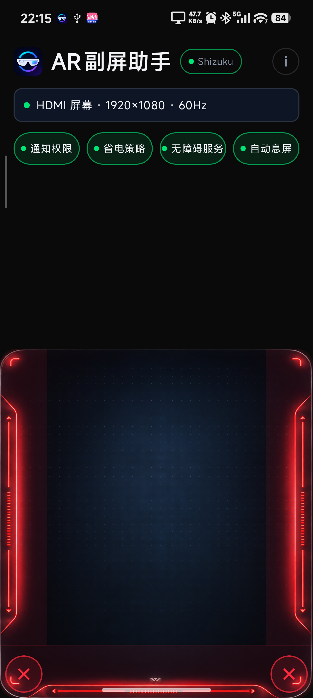
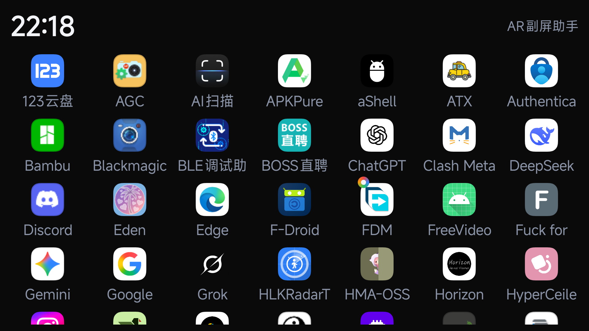

# AR 副屏助手 (AutoResolution)

为 **XREAL ONE AR 眼镜**适配的程序：眼镜通过 USB-C DP(DisplayPort Alt Mode)接入手机后，系统将其识别为外接显示器——手机变身触控板，眼镜变成大屏启动页。连接后主屏自动息屏（黑屏），触控板在黑屏下照常可用；摘下眼镜自动恢复亮度。

<div align="center">

| 主屏 · 触控板（HUD 暗黑风） | 副屏 · 启动页与触点 |
|---|---|
|  |  |

</div>

## 功能

- **双屏触控板** — 手机化身触控板：中部滑动移动触点、轻点即点击、左右边缘上下滑滚动、底部边缘左右滑横向滚动；触点实时渲染在眼镜屏上
- **息屏触摸** — 眼镜连接后主屏自动息屏（只关背光、电源保持 ON），黑屏下触控板照常工作；摘下眼镜自动恢复亮度与亮度模式。HUD 界面「自动息屏」开关可随时关闭
- **副屏启动页** — 眼镜上显示时钟 + 应用网格，注入点击跨屏启动应用；触控板角落 ✕ 一键关闭副屏当前应用
- **可信触点** — 触点经无障碍 `TYPE_ACCESSIBILITY_OVERLAY` 渲染，穿透它的点击/滚动不会被目标 App 丢弃（Android 12+ 拦截不可信 overlay）
- **权限自动授予** — Shizuku 授权后自动授予通知权限、电池优化白名单、自动开启无障碍触点服务（掉绑自动重绑），全程无弹窗
- **开机自启** — 权限齐全时开机自动启动后台监听（国产 ROM 需手动允许自启动一次）
- **链路保护** — DP 链路训练降级（如只剩 640×480 兜底档）时自动检测并提示重新插拔

## 工作原理

```
XREAL ONE 眼镜接入 (USB-C DP，系统识别为外接显示器)
        │
        ├─ 触点   → 无障碍可信 overlay 渲染在副屏（触摸可穿透）
        ├─ 注入   → Shizuku InputInjectorService 反射 injectInputEvent
        │           + InputEvent.setDisplayId 定向副屏
        │           └─ 失败自动降级 shell `input -d <displayId>` 命令
        ├─ 息屏   → Shizuku DisplayControlService 反射
        │           SurfaceControl.setDisplayBrightness(token, -1)
        │           └─ 电源模式保持 ON：系统不感知灭屏，触摸照常上报
        └─ 拔出   → 恢复亮度/亮度模式，关闭启动页与触点
```

所有提权操作（事件注入、屏幕亮度、权限授予）均通过 **Shizuku** 以 shell 身份执行，无需 Root。

> 为什么息屏要用「亮度 -1」而不是电源模式关屏：`setDisplayPowerMode(OFF)` 会让触摸控制器断电、Activity 进入生命周期暂停，触控板直接失效；`setDisplayBrightness(-1)` 只关背光，系统层面屏幕仍是点亮状态，触摸管线完整保留——这是黑屏下触控板可用的关键。

## 权限说明

| 权限 | 获取方式 |
|---|---|
| Shizuku | 首次使用在界面点击「Shizuku」授权 |
| 通知权限 | Shizuku 自动授予（`pm grant`） |
| 省电策略无限制 | 自动加入电池优化白名单 |
| 无障碍触点服务 | 经 Shizuku 自动开启，无需手动设置 |
| 开机自启 | 国产 ROM 需在自启动管理中手动开启一次 |

## 构建与安装

```bash
./gradlew :app:assembleRelease
adb install -r app/build/outputs/apk/release/app-release.apk
```

> 需要预先安装 [Shizuku](https://shizuku.rikka.app/download/) 并启动服务（无线调试或 adb）。
> 可直接从 [Releases](https://github.com/Felix8568/AutoResolution/releases) 下载安装包。

## 技术栈

- Kotlin + Jetpack Compose（Material3，HUD 暗黑霓虹主题）；副屏启动页为传统 View（程序化构建）
- MVVM + 单向数据流（UDF）：`StateFlow` + `MainViewModel` + sealed `MainEvent`
- [Shizuku API](https://github.com/RikkaApps/Shizuku)：三个 UserService —— 事件注入 / SurfaceControl 亮度与电源 / shell 命令
- 隐藏 API 反射：`injectInputEvent`（Android 14 起迁移至 InputManagerGlobal）、`InputEvent.setDisplayId`、`SurfaceControl.setDisplayBrightness`、`DisplayControl`（Android 14+ 需加载 services.jar 获取 display token）
- 无障碍可信触点 overlay + 主屏自定义触控板 View（分区手势识别）

## 兼容性

- 手机需支持 USB-C DP 输出（DisplayPort Alt Mode，小米 15 等支持 DP 的机型可直接使用）
- 适配 **XREAL ONE / XREAL ONE Pro** AR 眼镜（系统识别为外接显示器的设备均可工作）
- Android 8.0+（minSdk 26，targetSdk 36）；**息屏触摸的亮度方案需 Android 12+**，更低版本自动降级为硬关屏（触摸不可用）
- 需安装 Shizuku 或 Sui
- 国产 ROM（小米/华为等）的自启动权限需手动开启

## 特别鸣谢（无先后顺序）

- [Extinguish](https://github.com/Moderpach/Extinguish) — 息屏触摸方案（`setDisplayBrightness(-1)` 关背光保触摸）与 SurfaceControl 控屏参考了此项目的实现思路与代码，特此鸣谢。
- [Shizuku](https://github.com/RikkaApps/Shizuku) — 提供 shell 身份提权能力，使本程序无需 Root 即可注入事件、控制屏幕与自动授予权限。
- [XREAL](https://www.xreal.com/) — AR 眼镜硬件与本程序的适配对象。
