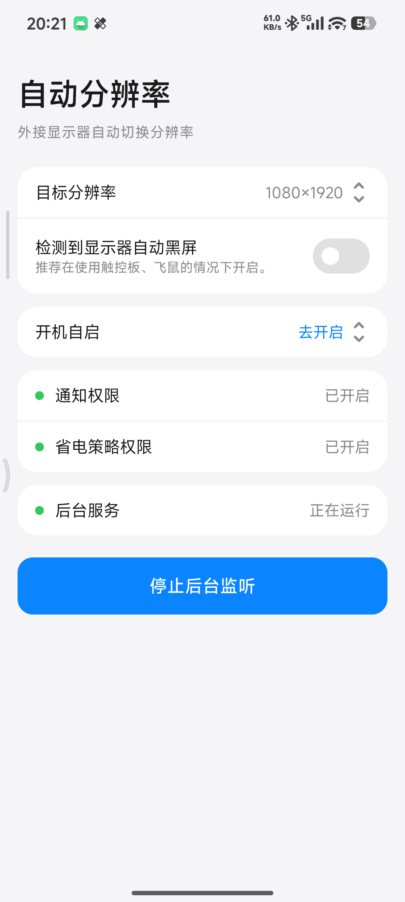

# 自动分辨率 (AutoResolution)

为 **XREAL ONE AR 眼镜**适配的程序:眼镜通过 USB-C DP(DisplayPort Alt Mode)接入手机后,系统将其识别为外接显示器,本程序自动切换目标分辨率、可选自动熄灭本机屏幕,摘下眼镜后自动还原。MIUI 风格界面。



## 功能

- **自动切换分辨率** — 检测到外接显示器(HDMI/DP)接入,自动执行 `wm size` 切换到目标分辨率;拔掉后自动还原
- **目标分辨率设置** — 默认跟随系统屏幕分辨率,可自定义,点击「还原」一键恢复系统分辨率
- **检测到显示器自动黑屏** — 开关开启时,外接显示器接入即关闭本机屏幕电源(仅外接显示器输出,推荐在使用触控板、飞鼠的情况下开启)
- **权限自动授予** — Shizuku 授权后自动静默授予通知权限与电池优化白名单,无任何权限弹窗
- **开机自启** — 声明 `RECEIVE_BOOT_COMPLETED`,权限齐全时开机自动启动后台服务(国产 ROM 需在系统自启动管理中手动开启一次)

## 工作原理

```
XREAL ONE 眼镜接入(USB-C DP,系统识别为外接显示器)
        │
        ├─ 接入 → wm size 切换目标分辨率(Shizuku ShellService)
        │        └─ 开关开启 → SurfaceControl 关闭本机屏幕电源(Shizuku DisplayControlService)
        │
        └─ 摘下 → wm size reset + 屏幕亮起
```

所有提权操作(修改分辨率、控制屏幕电源、授予权限)均通过 **Shizuku** 以 shell 身份执行,无需 Root、无需悬浮窗、无需无障碍。

## 权限说明

| 权限 | 获取方式 |
|---|---|
| Shizuku | 首次使用需在界面点击「授予 Shizuku 权限」 |
| 通知权限 | Shizuku 授权后自动授予(`pm grant`,同步通知开关状态) |
| 省电策略无限制 | Shizuku 授权后自动加入电池优化白名单 |
| 开机自启 | 国产 ROM 需手动开启(界面有蓝色链接引导至系统设置) |

## 构建与安装

```bash
# 构建
./gradlew :app:assembleDebug

# 安装
adb install -r app/build/outputs/apk/debug/app-debug.apk
```

> 需要预先安装 [Shizuku](https://shizuku.rikka.app/download/) 并启动服务(无线调试或 adb)。

## 技术栈

- Kotlin + Jetpack Compose(Material3,MIUI 风格定制主题)
- MVVM + 单向数据流(UDF):`StateFlow` + `MainViewModel` + sealed `MainEvent`
- [Shizuku API](https://github.com/RikkaApps/Shizuku):UserService 提权执行 `wm size`、SurfaceControl 控屏
- SharedPreferences 持久化设置(目标分辨率、自动黑屏开关)

## 兼容性

- **手机需支持 USB-C DP 输出**(DisplayPort Alt Mode,小米 15 等支持 DP 的机型可直接使用)
- 适配 **XREAL ONE / XREAL ONE Pro** AR 眼镜(系统识别为外接显示器的设备均可工作)
- Android 8.0+ (minSdk 24, targetSdk 36)
- 需安装 Shizuku 或 Sui
- 国产 ROM(小米/华为等)的自启动权限需手动开启

## 特别鸣谢（无先后顺序）

- [Extinguish](https://github.com/Moderpach/Extinguish) — 屏幕电源控制(SurfaceControl 控屏)参考了此项目的实现思路与代码,特此鸣谢。
- [Shizuku](https://github.com/RikkaApps/Shizuku) — 提供 shell 身份提权能力,使本程序无需 Root 即可修改分辨率、控制屏幕电源与自动授予权限。
- [XREAL](https://www.xreal.com/) — AR 眼镜硬件与本程序的适配对象。
